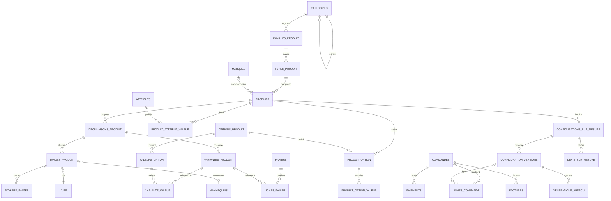

# MLD V2 — Vertex E-commerce Étudiants

**Statut :** proposition de modèle logique relationnel pour validation métier, avant MPD et migrations Laravel/MySQL 8.4  
**Date :** 13 octobre 2026  
**Référence prioritaire :** `Catalogue_Maitre_V2_12_Modeles(1).xlsx` (notamment `Architecture_Catalogue`, `Types_Produits`, `Fiches_Modèles`, `Dictionnaire_ADN`, `Déclinaisons_Visuelles`, `Variantes_Commerciales`, `Bibliothèques_Visuelles`, `Plan_Images_576`, `Correspondance_BDD`).  
**Base à préserver :** `projet_ecommerce_vertex_etudiants.sql`.  
**Compléments métier confirmés :** trois résolutions par image, navigation interactive Nuxt, produit similaire, personnalisation assistée par IA.

## 1. Conventions et principes

- `PK` : clé primaire ; `FK` : clé étrangère ; `UQ` : contrainte unique ; `NN` : non nul ; `NULL` : optionnel.
- Types indiqués pour MySQL 8.4 : `BIGINT UNSIGNED`, `VARCHAR(n)`, `DECIMAL(p,s)`, `DATETIME`, `JSON`, `BOOLEAN` (alias `TINYINT(1)`), `TEXT`.
- Les colonnes `cree_le`, `modifie_le` sont implicitement prévues pour les entités modifiables, sauf indication contraire. `modifie_le` n'est pas requis sur les journaux immuables.
- Les cardinalités indiquent les contraintes permanentes, **pas** les volumes actuels du pilote. Les volumes Excel sont : 1 univers, 2 segments, 6 familles, 12 types, 12 modèles, 72 déclinaisons, 288 SKU, 576 images logiques, 1 728 fichiers si chaque image dispose exactement de trois résolutions.
- Les mots **« proposition »**, **« à décider »** signalent des choix nouveaux ou non prescrits littéralement par le catalogue Excel ; ils ne doivent pas être considérés comme déjà approuvés.
- Identifiants `code_*` métiers issus d'Excel ≠ clés primaires auto-incrémentées en base. Ne pas inférer une FK à partir d'une partie de SKU.

## 2. Modèle d'ensemble

> La cardinalité `PRODUITS → CONFIGURATIONS_SUR_MESURE` est **facultative côté configuration** (création libre possible). Certains moteurs Mermaid n'expriment pas cet aspect clairement : se reporter aux FKs ci-dessous.

## 3. Classification et catalogue

### 3.1 CATEGORIES [ADAPTER]

`CATEGORIES(id PK, parent_id FK? → categories.id, niveau VARCHAR(20) NN, nom VARCHAR(150) NN, slug VARCHAR(190) NN UQ, description TEXT?, image VARCHAR(500)?, active BOOLEAN NN, ordre_affichage INT NN)`

- `niveau ∈ {univers, segment}` ; racine `Mode`, enfants `Homme` et `Femme`.
- Contrainte métier : un **segment** possède un parent de niveau `univers` ; un **univers** n'a pas de parent ; cycles interdits (validation transactionnelle/service).
- **Migration :** anciennes catégories `Chemises`, `Vestes`, `Robes`, `Jupes` ne doivent pas être renommées directement en segments. Les mapper vers `familles_produit` (préserver leurs IDs tant que des références subsistent).

### 3.2 FAMILLES_PRODUIT [NOUVELLE]

`FAMILLES_PRODUIT(id PK, segment_id FK → categories.id, code VARCHAR(40) NN UQ, nom VARCHAR(150) NN, slug VARCHAR(190) NN UQ, description TEXT?, active BOOLEAN NN, ordre_affichage INT NN)`

- Dans V2 : Chemises, Vestes, Pantalons, Jupes, Robes, Chaussures ; selon le besoin de navigation, une même famille peut être réutilisée entre segments. **Arbitrage :** si cette réutilisation est requise, déplacer `segment_id` vers une association `segment_famille` et éviter les duplications ; pour le pilote, rattachement à un segment.

### 3.3 TYPES_PRODUIT [NOUVELLE]

`TYPES_PRODUIT(id PK, famille_id FK → familles_produit.id, code_type VARCHAR(60) NN UQ, nom VARCHAR(150) NN, slug VARCHAR(190) NN UQ, description TEXT?, active BOOLEAN NN, ordre_affichage INT NN)`

- Référence exacte `Types_Produits` : `TYP-CH-BUS-001`, etc. La famille du type et son segment sont inférés par la hiérarchie.

### 3.4 MARQUES [CONSERVER]

`MARQUES(id PK, nom VARCHAR(150) NN UQ, slug VARCHAR(190) NN UQ, description TEXT?, logo VARCHAR(500)?, active BOOLEAN NN)`.

### 3.5 PRODUITS [ADAPTER]

`PRODUITS(id PK, code_modele VARCHAR(60) NN UQ, type_produit_id FK → types_produit.id, marque_id FK? → marques.id, cree_par FK? → utilisateurs.id, nom VARCHAR(190) NN, slug VARCHAR(190) NN UQ, description_courte TEXT?, description_longue LONGTEXT?, description_source TEXT?, prix_base DECIMAL(12,2)?, devise CHAR(3) NN DEFAULT 'USD', statut VARCHAR(30) NN, produit_mis_en_avant BOOLEAN NN, publie_le DATETIME?)`.

- `code_modele` depuis `Fiches_Modèles` ; exemple : `MOD-CH-BUS-001`, *L'Exécutif*.
- Les caractéristiques physiques constituent l'**ADN**, et non des SKU de matières fictifs.
- `prix_base` est indicatif ou sert au calcul tarifaire ; prix transactionnel au niveau SKU, et prix d'affichage au niveau déclinaison suivant règle § 12.
- Ne pas mélanger le statut du produit avec celui de l'image ou de la déclinaison.

### 3.6 ATTRIBUTS [NOUVELLE]

`ATTRIBUTS(id PK, code VARCHAR(80) NN UQ, nom VARCHAR(120) NN, type_valeur VARCHAR(20) NN, unite VARCHAR(30)?, description TEXT?, actif BOOLEAN NN)`.

- `type_valeur ∈ {texte, nombre, booleen, choix, json}` ; domaines : coupe, matière, texture, col/taille/tige, manches, poignets/bord, fermeture, poches, construction, finitions, longueur, occasions, saison, etc., selon `Dictionnaire_ADN`.

### 3.7 TYPE_ATTRIBUT [NOUVELLE]

`TYPE_ATTRIBUT(type_produit_id PK FK → types_produit.id, attribut_id PK FK → attributs.id, obligatoire BOOLEAN NN, visible_fiche BOOLEAN NN, utilise_prompt BOOLEAN NN, ordre_affichage INT NN)`.

- À initialiser depuis les types et le dictionnaire ADN. Ne pas rendre tous les attributs applicables à toutes les familles.

### 3.8 PRODUIT_ATTRIBUT_VALEUR [NOUVELLE]

`PRODUIT_ATTRIBUT_VALEUR(produit_id PK FK → produits.id, attribut_id PK FK → attributs.id, valeur_texte TEXT?, valeur_nombre DECIMAL(14,4)?, valeur_bool BOOLEAN?, valeur_json JSON?)`.

- Vérifier qu'un seul champ de valeur est renseigné selon `attributs.type_valeur` (règle applicative / triggers ou CHECK adéquats).
- L'attribut doit être autorisé pour le type du produit et tous les attributs obligatoires doivent être présents **avant publication**.

### 3.9 DECLINAISONS_PRODUIT [NOUVELLE, pivot central]

`DECLINAISONS_PRODUIT(id PK, produit_id FK → produits.id, code_declinaison VARCHAR(80) NN UQ, slug VARCHAR(190) NN UQ, type_declinaison VARCHAR(40) NN, couleur_principale VARCHAR(120)?, motif VARCHAR(150)?, couleur_hex CHAR(7)?, chemin_pastille VARCHAR(500)?, description_courte TEXT?, complement_long TEXT?, prix_affiche DECIMAL(12,2)?, devise CHAR(3) NN DEFAULT 'USD', active BOOLEAN NN, ordre_affichage INT NN)`.

- Depuis `Déclinaisons_Visuelles`, ex. `DCL-CH-BUS-001-01` = Blanc optique / Uni / 59 USD.
- Le type de déclinaison (`Couleur`, `Motif` ou autres valeurs futures) n'est pas une restriction forte aux deux seuls libellés d'aujourd'hui.
- Pour des motifs, la pastille utilise une image d'échantillon (`chemin_pastille`) plutôt qu'un code HEX arbitraire.
- Une déclinaison est **un état visuel commercialisable** du modèle, pas une simple valeur globale d'option : combinaison couleur/motif propre au modèle.

### 3.10 PRODUIT_CATEGORIE [À RÉÉVALUER]

L'ancienne `PRODUIT_CATEGORIE` ne doit pas dupliquer le chemin canonique type → famille → segment. Deux solutions : (a) migrer vers `PRODUIT_COLLECTION` pour des regroupements éditoriaux ; (b) supprimer après migration et contrôle des dépendances. **Ne pas décider avant validation des usages de navigation**.

## 4. Variantes, options et stocks

### 4.1 OPTIONS_PRODUIT [CONSERVER, RÉORIENTER]

`OPTIONS_PRODUIT(id PK, nom VARCHAR(100) NN UQ, code VARCHAR(100) NN UQ, type_affichage VARCHAR(30) NN, active BOOLEAN NN)`.

- Sert aux options sélectionnables qui déterminent le SKU (`taille`, éventuellement `matiere` lorsqu'elle est réellement un choix commercial). L'option `apparence` est historiquement présente ; le choix visuel doit désormais se faire par `declinaisons_produit` et non par une seconde identification concurrente.

### 4.2 VALEURS_OPTION [CONSERVER]

`VALEURS_OPTION(id PK, option_id FK → options_produit.id, valeur VARCHAR(150) NN, code_couleur VARCHAR(20)?, image VARCHAR(500)?, ordre_affichage INT NN, UQ(option_id,valeur), UQ(option_id,id))`.

### 4.3 PRODUIT_OPTION [CONSERVER]

`PRODUIT_OPTION(produit_id PK FK → produits.id, option_id PK FK → options_produit.id, obligatoire BOOLEAN NN, ordre_affichage INT NN)`.

### 4.4 PRODUIT_OPTION_VALEUR [CONSERVER, ADAPTER]

`PRODUIT_OPTION_VALEUR(produit_id PK FK, option_id FK, valeur_option_id PK FK, active BOOLEAN NN, ordre_affichage INT NN)`.

- FKs composées existantes vers `produit_option` et `valeurs_option` à maintenir ; un SKU ne peut utiliser qu'une valeur autorisée pour son modèle.

### 4.5 VARIANTES_PRODUIT [ADAPTER]

`VARIANTES_PRODUIT(id PK, produit_id FK → produits.id [TRANSITOIRE], declinaison_id FK NN → declinaisons_produit.id, sku VARCHAR(100) NN UQ, code_barres VARCHAR(100)? UQ, nom_variante VARCHAR(190)?, prix DECIMAL(12,2) NN, prix_compare DECIMAL(12,2)?, cout_achat DECIMAL(12,2)?, quantite_stock INT UNSIGNED NN, seuil_stock_faible INT UNSIGNED NN, poids DECIMAL(10,3)?, active BOOLEAN NN, variante_par_defaut BOOLEAN NN)`.

- Recommandation cible : **retirer `produit_id` redondant après migration** ; joindre via `declinaison_id → produit_id`. Le conserver seulement durant la transition et l'encadrer pour interdire une incohérence.
- SKU V2 depuis `Variantes_Commerciales`, ex. `CH-BUS-001-BO-U-M` ; variante commercialisable identifiée par déclinaison + combinaison d'options (taille, ...).
- `quantite_stock` reste disponible au SKU (pas au modèle et pas à la déclinaison).
- Interdire `prix < 0`, `prix_compare < 0`, `cout_achat < 0`, quantités négatives ; documenter stock réservé séparément si vente concurrente.
- La règle **une seule variante par défaut par produit** doit être portée par un index conditionnel simulé / colonne générée (ou politique sur déclinaison), non un simple booléen libre.

### 4.6 VARIANTE_VALEUR [CONSERVER]

`VARIANTE_VALEUR(variante_id PK FK → variantes_produit.id, valeur_option_id PK FK → valeurs_option.id)`.

- Conserver les validations des triggers existants qui vérifient option autorisée et **au plus une valeur par option**. Vérifier qu'une variante est complète avant activation.
- **Unicité des combinaisons** : stocker une signature canonique calculée au niveau `variantes_produit` (`signature_options`, UQ(`declinaison_id`,`signature_options`)), calculée transactionnellement par le service Laravel après tri des couples option/valeur ; ne pas concaténer de manière ambiguë.

### 4.7 MOUVEMENTS_STOCK [CONSERVER]

Conserver les champs SQL existants : `id`, `variante_id`, `utilisateur_id?`, `type`, `quantite`, `stock_avant`, `stock_apres`, `reference_type?`, `reference_id?`, `motif?`, `cree_le`.

- Les réservations et retraits doivent être atomiques ; ajouter facultativement `RESERVATIONS_STOCK` (id, variante_id, ligne_panier_id?, commande_id?, quantite, expire_le, statut), selon politique de stock retenue.

## 5. Photothèque, trois résolutions et vues

### 5.1 VUES [NOUVELLE]

`VUES(id PK, code VARCHAR(30) NN UQ, nom VARCHAR(80) NN, description TEXT?, ordre_recommande INT NN, active BOOLEAN NN)`.

- Initialiser depuis `Bibliothèques_Visuelles`: `VUE-01 Face`, `VUE-02 Dos`, `VUE-03 Profil`, `VUE-04 Trois-quarts` ; les vues additionnelles (détails, lifestyle) restent possibles.

### 5.2 MANNEQUINS [NOUVELLE, référentiel de production pouvant rester privé]

`MANNEQUINS(id PK, code VARCHAR(30) NN UQ, nom VARCHAR(120) NN, segment VARCHAR(30)?, description TEXT?, chemin_reference VARCHAR(500)?, actif BOOLEAN NN)`.

- `MH-01`, `MH-02`, `MF-01`, `MF-02` ; leur présence dans la base de production est nécessaire pour garantir la traçabilité. La fiche publique n'a pas besoin d'en montrer les codes.

### 5.3 IMAGES_PRODUIT [CONSERVER, RESTRUCTURER]

`IMAGES_PRODUIT(id PK, code_image VARCHAR(120) NN UQ, declinaison_id FK NN → declinaisons_produit.id, vue_id FK NN → vues.id, mannequin_id FK? → mannequins.id, texte_alternatif VARCHAR(255)?, image_principale BOOLEAN NN DEFAULT FALSE, ordre_affichage INT UNSIGNED NN, statut VARCHAR(30) NN DEFAULT 'a_generer', publie_le DATETIME?)`.

- Une ligne = **une photographie logique**, et non une taille de fichier.
- `UQ(declinaison_id, vue_id, mannequin_id)` **uniquement si** la règle « une image par combinaison vue + mannequin » est définitive. Pour rester extensible aux prises multiples/lifestyle, préférer `code_image UQ` seulement, avec contrôle qualité et ordre.
- **Une seule image principale par déclinaison** : colonne générée `cle_principale = CASE WHEN image_principale=1 AND statut='publie' THEN declinaison_id ELSE NULL END`, index UNIQUE. L'application doit en garantir l'existence avant publication de la déclinaison.
- `ordre_affichage` peut être dupliqué temporairement pendant un réordonnancement ; si l'on veut une unicité stricte, l'effectuer transactionnellement après mise en ordre.
- **Transition depuis ancien SQL** : le couple `produit_id + valeur_apparence_id` sera remplacé par `declinaison_id` après rapprochement des données ; ne pas conserver simultanément deux vérités non synchronisées.

### 5.4 FICHIERS_IMAGES [NOUVELLE]

`FICHIERS_IMAGES(id PK, image_produit_id FK NN → images_produit.id, profil VARCHAR(30) NN, chemin_stockage VARCHAR(500) NN UQ, mime VARCHAR(80) NN, format VARCHAR(15) NN, largeur INT UNSIGNED NN, hauteur INT UNSIGNED NN, taille_octets BIGINT UNSIGNED?, checksum_sha256 CHAR(64)?, etat_traitement VARCHAR(30) NN, genere_le DATETIME?, UQ(image_produit_id,profil))`.

- `profil ∈ {miniature, moyenne, originale}` initialement ; dimensions conseillées (à confirmer avec maquettes) : **320×400, 960×1200, 2400×3000** (ratio 4:5). Si l'original a un autre ratio, générer des dérivés au **même ratio**, sans étirement ; recadrage explicite si requis.
- Le `originale` est conservé en qualité élevée. Les profils `moyenne`, `miniature` sont produits de manière asynchrone et contrôlés ; ne pas déclarer une image `publie` si les profils requis manquent.
- WebP/AVIF possibles pour les dérivés ; ne pas supprimer un original avant sauvegarde durable.
- **Nuxt** : miniature pour rail et pastilles à image, moyenne pour galerie principale, originale récupérée **à l'activation du zoom** via URL autorisée. `srcset` n'assure pas seul cette bascule.
- 576 images × 3 profils = 1 728 fichiers attendus ; cela représente un objectif de production, pas une contrainte globale de schéma.

### 5.5 Bibliothèques IA externes (choix recommandé pour le pilote)

Les `postures`, `decors`, prompts, références de construction et tentatives peuvent rester dans les fichiers du pipeline ou dans une base administrative dédiée. Le catalogue public n'a besoin que du `code_image`, du résultat validé et de ses fichiers. Si production intégrée : ajouter des tables `RESSOURCES_VISUELLES`, `PRODUCTION_IMAGE`, `TENTATIVES_GENERATION` dans un sous-schéma séparé.

## 6. Suggestions et découverte

### 6.1 PRODUIT_RECOMMANDATION [NOUVELLE]

`PRODUIT_RECOMMANDATION(produit_source_id PK FK → produits.id, produit_cible_id PK FK → produits.id, type_relation PK VARCHAR(30), score_priorite INT NN DEFAULT 0, active BOOLEAN NN)`.

- `type_relation ∈ {similaire, complementaire, editorial}`. Exclure l'auto-liaison ; retourner uniquement les produits publiés. Les recommandations automatiques « même type/famille » peuvent être calculées en requête sans créer de lignes explicites.
- Suggestions fondées sur la catégorie et les attributs ≠ recommandations éditoriales manuelles : garder les deux logiques distinctes.

## 7. Identité et commerce — préservation du socle

Les tables ci-dessous sont conservées **conceptuellement avec les champs/contraintes présents dans le SQL fourni**, sauf ajustements précisés. Leurs définitions exhaustives demeurent celles de l'export SQL, incorporées ici par référence pour éviter toute divergence silencieuse.

| Table | Décision | Raccord / point de contrôle |
|---|---|---|
| `utilisateurs` | CONSERVER + CORRIGER SÉCURITÉ | Hash fort du mot de passe ; jamais de clair, révocation/rotation de l'identifiant exposé |
| `roles` | CONSERVER | rôles disponibles |
| `utilisateur_role` | CONSERVER | clé composite et FKs |
| `codes_verification` | CONSERVER | conserver `code_hash`, expiration et tentatives |
| `adresses` | CONSERVER | géographie RDC pertinente |
| `paniers` | CONSERVER | panier connecté/invité, contraintes d'unicité |
| `lignes_panier` | CONSERVER/ADAPTER | `variante_id` standard ; ajout de voie sur-mesure à décider ; contrôles stock à sécuriser contre concurrence |
| `commandes` | CONSERVER | totaux, devise, statut, utilisateur |
| `lignes_commande` | ADAPTER | prix/produit/SKU en instantané ; lier soit SKU, soit version sur mesure immuable |
| `adresses_commande` | CONSERVER | instantané adresse par commande |
| `historiques_statut_commande` | CONSERVER | audit métier |
| `modes_paiement` | CONSERVER | Stripe/Mobile Money : fournisseurs effectifs à revalider |
| `paiements` | CONSERVER | plusieurs tentatives et traitements partiels possibles |
| `transactions_paiement` | CONSERVER | payloads sensibles : rétention et filtrage |
| `factures` | ADAPTER | lever UQ systématique sur `paiement_id` ou `commande_id` si avoirs, acomptes ou documents multiples requis |
| `mouvements_stock` | CONSERVER | rattachement au SKU |
| `marques` | CONSERVER | rattachement facultatif au produit |

### 7.1 LIGNES_COMMANDE — ajout ciblé

Conserver la ligne historique (`nom_produit`, `sku`, `description_variante`, `prix_unitaire`, `quantite`, `montant_remise`, `montant_total`, `image`) et ajouter :

`type_ligne VARCHAR(20) NN DEFAULT 'standard'`, `configuration_version_id FK? → configuration_versions.id`, `devis_sur_mesure_id FK? → devis_sur_mesure.id`.

Règle exclusive proposée :

- `type_ligne='standard'` → `variante_id NOT NULL`, `configuration_version_id NULL` ;
- `type_ligne='sur_mesure'` → `variante_id NULL`, `configuration_version_id NOT NULL`, devis validé applicable.

Le snapshot figé des options du sur-mesure (`configuration_snapshot JSON` proposé) peut être stocké sur la ligne pour conserver la preuve contractuelle même si des référentiels évoluent. **Aucun SKU permanent obligatoire** pour chaque commande personnalisée : un code de fabrication temporaire peut suffire.

### 7.2 FACTURES et DEVIS

La table actuelle a `UQ(commande_id)` et `UQ(paiement_id)`. Les maintenir seulement si une commande engendre exactement une facture et un paiement facturé unique. Sinon, introduire `type_document`, liaisons adaptées et avoirs ; ne pas casser l'historique sans arbitrage financier.

## 8. Atelier sur-mesure piloté par IA — nouveau domaine

### 8.1 OPTIONS_PERSONNALISATION [NOUVELLE]

`OPTIONS_PERSONNALISATION(id PK, type_produit_id FK? → types_produit.id, code VARCHAR(80) NN UQ, nom VARCHAR(150) NN, nature VARCHAR(40) NN, type_saisie VARCHAR(30) NN, obligatoire BOOLEAN NN, conditions_json JSON?, plage_json JSON?, prix_supplementaire DECIMAL(12,2)?, actif BOOLEAN NN)`.

- Exemples : coupe, matière, col, mesure personnalisée, logo, écusson, motif personnel, placement broderie. Les règles de compatibilité et prix sont évaluées **côté serveur** ; l'IA ne les décide pas.
- Un catalogue de valeurs structurées ou table `VALEURS_PERSONNALISATION` peut être ajouté pour les options de type choix.

### 8.2 CONFIGURATIONS_SUR_MESURE [NOUVELLE]

`CONFIGURATIONS_SUR_MESURE(id PK, reference VARCHAR(100) NN UQ, utilisateur_id FK? → utilisateurs.id, jeton_invite_hash VARCHAR(255)?, produit_base_id FK? → produits.id, type_produit_id FK? → types_produit.id, statut VARCHAR(30) NN, version_courante_id FK? → configuration_versions.id, expire_le DATETIME?)`.

- Modèle de base facultatif : création libre possible ; au minimum le type ou une description métier doit permettre validation.
- États proposés : `brouillon`, `en_revision`, `soumis`, `en_etude`, `devis_propose`, `devis_accepte`, `commande`, `abandonne`.
- `version_courante_id` crée une dépendance circulaire : la rendre nullable et la gérer après création ; alternative plus simple : déduire la dernière version approuvée par requête.

### 8.3 CONFIGURATION_VERSIONS [NOUVELLE]

`CONFIGURATION_VERSIONS(id PK, configuration_id FK NN → configurations_sur_mesure.id, numero_version INT UNSIGNED NN, description_libre TEXT?, choix_json JSON NN, mesures_json JSON?, notes_client TEXT?, statut_validation VARCHAR(30) NN, validee_le DATETIME?, UQ(configuration_id,numero_version))`.

- Versions **immuables** après soumission/validation ; chaque révision produit une nouvelle version ; toutes les valeurs utiles à la fabrication doivent être figées.
- Les unités des mensurations sont explicites et normalisées (`cm`, etc.), avec plages raisonnables par mesure.

### 8.4 CONFIGURATION_VALEURS [NOUVELLE, optionnelle si normalisation stricte souhaitée]

`CONFIGURATION_VALEURS(id PK, configuration_version_id FK NN, option_personnalisation_id FK NN, valeur_texte TEXT?, valeur_nombre DECIMAL(12,3)?, valeur_code VARCHAR(120)?, unite VARCHAR(20)?, UQ(configuration_version_id,option_personnalisation_id))`.

- À adopter pour requêtes analytiques, contrôles et tarification structurée. `choix_json` reste un snapshot versionné ; il ne doit pas constituer une seconde vérité modifiable indépendamment.

### 8.5 FICHIERS_PERSONNALISATION [NOUVELLE]

`FICHIERS_PERSONNALISATION(id PK, configuration_id FK NN, version_id FK? → configuration_versions.id, utilisateur_id FK?, nature VARCHAR(30) NN, chemin_prive VARCHAR(500) NN, mime_reel VARCHAR(80) NN, taille_octets BIGINT UNSIGNED NN, checksum_sha256 CHAR(64)?, etat_controle VARCHAR(30) NN, droits_declares BOOLEAN NN, cree_le DATETIME NN)`.

- Dépôts privés, types autorisés, scan antivirus, expiration et accès signé. Les droits d'usage sur logos/motifs doivent être déclarés par l'utilisateur.

### 8.6 GENERATIONS_APERCU [NOUVELLE]

`GENERATIONS_APERCU(id PK, configuration_version_id FK NN → configuration_versions.id, numero_tentative INT UNSIGNED NN, fournisseur VARCHAR(80) NN, modele_ia VARCHAR(120)?, prompt_reference VARCHAR(500)?, parametres_json JSON?, statut VARCHAR(30) NN, chemin_apercu_prive VARCHAR(500)?, chemin_reference_prive VARCHAR(500)?, cout_estime DECIMAL(12,4)?, erreur_sanitaire TEXT?, genere_le DATETIME?, UQ(configuration_version_id,numero_tentative))`.

- États : `en_attente`, `en_cours`, `terminee`, `refusee`, `echec`, `annulee` ; job asynchrone, contrôle de quota, coûts, modération et traces minimisées.
- **L'aperçu IA est indicatif, pas une garantie de fabrication fidèle.** Il ne doit jamais remplacer la configuration structurée validée.

### 8.7 DEVIS_SUR_MESURE [NOUVELLE]

`DEVIS_SUR_MESURE(id PK, numero_devis VARCHAR(100) NN UQ, configuration_version_id FK NN → configuration_versions.id, utilisateur_id FK? → utilisateurs.id, devise CHAR(3) NN, prix_base DECIMAL(12,2) NN, supplements DECIMAL(12,2) NN, livraison_estimee DECIMAL(12,2)?, taxe_estimee DECIMAL(12,2)?, total DECIMAL(12,2) NN, delai_fabrication_jours INT?, statut VARCHAR(30) NN, expire_le DATETIME?, accepte_le DATETIME?, valide_par FK? → utilisateurs.id)`.

- Plusieurs révisions de devis possibles ; l'acceptation doit identifier **une version précise** de configuration, un prix et une durée de validité ; commande liée au devis accepté.

### 8.8 Commandes mixtes

Le panier actuel `lignes_panier(variante_id NOT NULL)` ne peut pas directement contenir du sur-mesure. Deux solutions possibles :

1. **Proposée pour MLD cible** : `lignes_panier.type_ligne`, `variante_id NULL`, `configuration_version_id NULL`, et contrainte exclusive (un seul identifiant présent) ; pour sur-mesure, seuls les devis approuvés peuvent devenir des commandes payables.
2. Préserver `lignes_panier` pour les SKU, ajouter `lignes_panier_sur_mesure` pour les configurations et agréger côté service. Plus conservateur pour une migration en production.

**Choix privilégié :** option 2 pour migration prudente si panier existant en production ; option 1 si projet non déployé, pour réduire le nombre de tables. Décision explicite à prendre avant MPD.

## 9. Contrats d'API et orchestration Nuxt (hors tables)

- `GET /api/produits/{slug}` : modèle, ADN visible, type, marque, déclinaisons actives, image principale moyenne, miniatures et SKU par déclinaison (prix et disponibilité).
- `GET /api/declinaisons/{id}` : fiche spécifique, galerie ordonnée, SKU valides ; le changement de pastille met à jour l'état client sans rafraîchir la route complète.
- `GET /api/images/{id}/zoom` : accès à l'original HD, uniquement à l'ouverture du zoom ; autorisations de diffusion adaptées aux images publiques ou privées.
- `GET /api/produits/{id}/recommandations` : similaires par type/famille + relations éditoriales.
- `POST /api/sur-mesure/configurations` ; `POST /{id}/versions` ; `POST /{id}/generations` ; `GET /generations/{id}` ; `POST /{id}/devis` : workflow authentifié ou session invitée sécurisée.
- Images responsives, `loading=lazy` pour vues secondaires, préchargement sélectif des images moyennes adjacentes, transition sans flash ; **ne jamais envoyer 576 originaux HD au navigateur**.
- Deux stratégies de concurrence : cache read-through du catalogue ; stock / tarifs vérifiés côté serveur à l'ajout au panier et au paiement.

## 10. Clés, indexes et intégrité : règles transverses

| Périmètre | Exigence |
|---|---|
| Modèles | `UQ(code_modele)`, `UQ(slug)` |
| Types | `UQ(code_type)`, `UQ(slug)` |
| Déclinaisons | `UQ(code_declinaison)`, `UQ(slug)`, `IDX(produit_id,active,ordre_affichage)` |
| SKU | `UQ(sku)`, `UQ(declinaison_id, signature_options)`, `IDX(declinaison_id,active,prix)` |
| Images | `UQ(code_image)`, `IDX(declinaison_id,statut,ordre_affichage)`, au plus une principale publiée par déclinaison |
| Fichiers images | `UQ(image_produit_id,profil)`, `UQ(chemin_stockage)` |
| Recommandations | PK composite `(produit_source_id, produit_cible_id, type_relation)` |
| Versions sur mesure | `UQ(configuration_id,numero_version)` ; version acceptée immuable |
| Panier / commande | référence à SKU **ou** à version sur mesure, jamais les deux ; montant en snapshot |
| Suppressions | RESTRICT si historique de commande/devis, CASCADE sur pivots purement techniques, `SET NULL` lorsque conserver l'historique le justifie |
| Sécurité | mots de passe uniquement hashés, journaux de paiement sans données carte sensibles, fichiers clients privés |

### 10.1 Règles que MySQL ne garantit pas simplement par FK

- `type_produit_id` cohérent avec attributs applicables ;
- existence d'une photo principale publiée ;
- présence de trois fichiers `originale/moyenne/miniature` et cohérence dimensionnelle ;
- exhaustivité des options obligatoires ;
- conformité d'une combinaison d'options à un SKU unique ;
- statut facture/devis/commande compatible ;
- visibilité de la galerie et couverture des variantes.

Ces invariants nécessitent des contrôles métiers transactionnels dans Laravel, avec contraintes SQL lorsque possible et tests d'intégration.

## 11. Correspondance Excel → BDD et fichiers

| Feuille Excel | Destination |
|---|---|
| `Architecture_Catalogue` | `categories`, `familles_produit`, `types_produit`, `produits` |
| `Types_Produits` | `types_produit`, `type_attribut` |
| `Fiches_Modèles` | `produits`, `produit_attribut_valeur` |
| `Dictionnaire_ADN` | `attributs`, `type_attribut` |
| `Déclinaisons_Visuelles` | `declinaisons_produit` |
| `Variantes_Commerciales` | `variantes_produit`, `variante_valeur`, valeurs autorisées |
| `Bibliothèques_Visuelles` | `vues`, `mannequins`; postures/décors en pipeline IA |
| `Plan_Images_576` | `images_produit` (plan), puis `fichiers_images` après traitement |
| `Prompts_Production` | pipeline IA externe, non publié |
| `Correspondance_BDD` | principes généraux recoupés par ce MLD |

**Anomalie d'identifiants détectée :** `Variantes_Commerciales.Image réutilisée` emploie parfois le suffixe `M01`, tandis que le plan image utilise `MH-01` / `MF-01`. Le rapprochement doit s'effectuer sur des `code_image` exacts, après normalisation **validée**. Ne jamais importer un chemin à partir d'une référence inexistante.

## 12. Prix, libellés et affichage — règles proposées à valider

1. Le prix d'une fiche est le prix du SKU sélectionné ; à défaut de taille, afficher le prix de la déclinaison (ou une fourchette si des tailles ont des prix distincts).
2. `declinaisons_produit.prix_affiche` provient de l'Excel et sert à l'affichage/catalogue ; si le SKU possède un autre prix, celui-ci prévaut à la transaction et un contrôle de concordance doit signaler l'écart.
3. L'image principale appartient à la **déclinaison**, non au SKU taille ; le retour aux vues de cette déclinaison est déterministe et suit `ordre_affichage`.
4. Les pastilles « couleur » utilisent code HEX seulement pour les unis ; les motifs utilisent un swatch image. Texte accessible obligatoire.
5. Le stock est calculé/disponible au niveau SKU ; n'afficher publiquement les quantités exactes que si la politique commerciale le souhaite.
6. Produit similaire = même type / attributs pertinents ; complémentaire = relation éditoriale ou moteur explicite.
7. Un aperçu sur-mesure validé reste versionné et privé jusqu'à une éventuelle autorisation explicite de publication.

## 13. Conservation, modification et ajout — bilan

### Conserver les concepts et les données pertinentes

`utilisateurs`, `roles`, `utilisateur_role`, `codes_verification`, `adresses`, `adresses_commande`, `paniers`, `commandes`, `historiques_statut_commande`, `modes_paiement`, `paiements`, `transactions_paiement`, `mouvements_stock`, `marques`, `options_produit`, `valeurs_option`, `produit_option`, `produit_option_valeur`, `variante_valeur`.

### Adapter

`categories`, `produits`, `variantes_produit`, `images_produit`, `lignes_panier`, `lignes_commande`, `factures`, et statut de `produit_categorie` à statuer.

### Ajouter

`familles_produit`, `types_produit`, `attributs`, `type_attribut`, `produit_attribut_valeur`, `declinaisons_produit`, `vues`, `mannequins`, `fichiers_images`, `produit_recommandation`, `options_personnalisation`, `configurations_sur_mesure`, `configuration_versions`, `configuration_valeurs` (optionnel), `fichiers_personnalisation`, `generations_apercu`, `devis_sur_mesure`, plus éventuelles réservations de stock.

## 14. Migration sûre — ordre recommandé

1. **Sauvegarder le dump et sécuriser les comptes** : le SQL transmis contient un mot de passe en clair ; rotation immédiate et hash sécurisé exigés. Ne pas redistribuer ce dump brut.
2. Ajouter les nouvelles tables de classification et charger `Mode → Homme/Femme → familles → types` depuis Excel.
3. Ajouter `code_modele`, `type_produit_id` aux produits ; migrer ou archiver l'ancien produit d'essai « Chemise Oxford Premium » sans le confondre avec *L'Exécutif*.
4. Charger les 12 modèles, les attributs ADN et les 72 déclinaisons avec des clés métiers stables.
5. Rattacher les 288 SKU d'exemple à `declinaison_id`. Contrôler signature d'options, prix, tailles et stocks. **Ne pas faire correspondre les vieux SKU Oxford par simple rapprochement nominal**.
6. Charger le plan des 576 images logiques avec statut `a_generer`, puis leurs trois fichiers dérivés uniquement après production et validation.
7. Supprimer/remplacer les index et triggers hérités fondés sur `valeur_apparence_id` **seulement après** avoir migré les liaisons correctement.
8. Ajouter commandes sur mesure et versions IA ; adapter panier et lignes de commande par migration incrémentale.
9. Tests d'intégrité : 12/72/288/576 attendus ; **1 728 fichiers uniquement après génération réelle**, cardinalités, images principales, options obligatoires, prix et stock, absence de liens cassés.
10. Déploiement Laravel via migrations idempotentes, seeders de référentiels séparés, backfill contrôlé et possibilité de rollback documentée (éviter les `DROP TABLE` automatiques sur environnement réel).

## 15. Arbitrages à valider avant le MPD

| Code | Question | Option recommandée |
|---|---|---|
| A1 | Une famille peut-elle couvrir plusieurs segments ? | Oui à terme via pivot `segment_famille`, si le besoin apparaît ; sinon garder FK simple pour V2 pilote |
| A2 | Matière : attribut ADN ou option commerciale ? | ADN par défaut, option SKU uniquement si choix réel |
| A3 | Prix déclinaison vs prix SKU ? | Prix SKU contractuel, prix déclinaison informatif et contrôlé |
| A4 | Galerie strictement 8 photos par déclinaison ? | Non : 8 au lancement ; extensible |
| A5 | Image principale sur chaque déclinaison ? | Oui à la publication, pas nécessaire pendant production |
| A6 | Paramètres de production IA catalogue ? | Fichiers/outil externe ; seules images validées sont exposées |
| A7 | Panier mixte standard / sur mesure ? | Oui, après acceptation d'un devis et selon adaptation retenue |
| A8 | Devis multiples, acomptes et factures multiples ? | Prévoir modèle extensible, définir processus financier précis |
| A9 | Référence visuelle d'un mannequin en base commerciale ? | Facultative et non publique |
| A10 | Stock réservé au panier ou à la validation de commande ? | Décider politique ; ne pas promettre stock au simple ajout panier |

## 16. Critères d'acceptation fonctionnelle

- [ ] Produits groupés par univers/segment/famille/type conformément à Excel V2.
- [ ] Une fiche par modèle et ADN consultable ; 6 déclinaisons chargées pour le pilote.
- [ ] Le changement de pastille met à jour galerie + prix et options sans rechargement complet de Nuxt.
- [ ] Les vues sont ordonnées et possèdent une principale explicite par déclinaison publiée.
- [ ] 576 images logiques, chacune reliée à 0–3 fichiers selon avancement ; publication uniquement avec les trois profils requis.
- [ ] Miniature → moyenne → originale HD au zoom ; aucune déformation de ratio.
- [ ] Les SKU tailles partagent la galerie de leur déclinaison ; stock et prix restent propres au SKU.
- [ ] Un SKU impossible, une combinaison doublonnée ou une valeur interdite est rejeté.
- [ ] Recommandations automatiques et associations éditoriales distinguées.
- [ ] Commandes classiques et personnalisées traçables, montants figés et historiques préservés.
- [ ] Le client peut réviser une configuration sur mesure ; chaque aperçu IA est attaché à une version.
- [ ] Un aperçu n'est jamais assimilé à une validation de fabricabilité.
- [ ] Aucune image client ou information de paiement sensible n'est publiée involontairement.

---

**Décision structurante :** le catalogue Excel V2 remplace le jeu de données de démonstration Oxford comme référentiel métier ; la base SQL antérieure demeure la source de conservation des entités transactionnelles, de leurs propriétés et de leurs mécanismes utiles. Ce document est un **MLD de conception détaillé**, non un script SQL exécutable ni un MPD arrêté : les arbitrages § 15 précèdent la génération des migrations.
